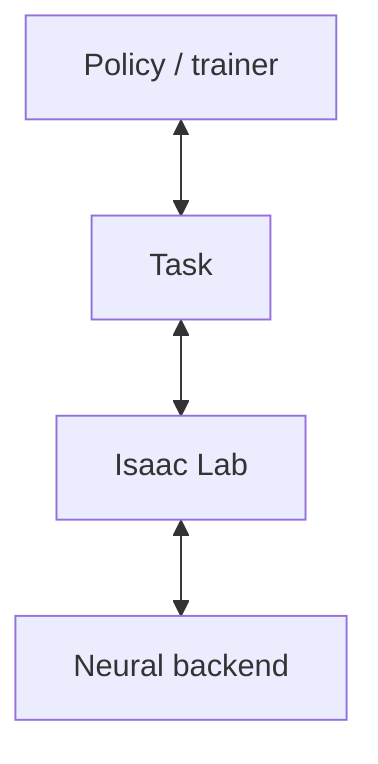

# Online RL with world model as simulator

Add learned dynamics through Isaac Lab's existing simulation and environment
lifecycle. Cosmos3 is the supplied backend; medical-pad unfolding demonstrates
recorded-action replay and policy training.

## Implementation



| Component | Responsibility |
| --- | --- |
| [NeuralDirectEnv / NeuralPhysicsManager](../isaaclab_contrib/neural/neural_env.py) | Native step/reset lifecycle, episode limits and terminal observations |
| [Cosmos3 backend](../isaaclab_contrib/neural/cosmos3/env_cfg.py) | Load the model and predict image clips from actions and the current image |
| [Medical-pad task](../../isaaclab_tasks/isaaclab_tasks/contrib/cosmos3_medical_pad_unfold/rlinf_env.py) | Initial conditions, robot-action conversion, classifier rewards and episode metrics |
| [RLinf adapter](../isaaclab_contrib/rl/rlinf/neural_env.py) | Run each task in its own simulator process and exchange policy rollout data |

A backend implements `_load_model`, `_reset_model`, `_step_model`, `_close_model`.
Declare matching action/observation spaces and environment counts; use
`decimation=1` and match `physics.step_dt` to `sim.dt` in seconds. Model hooks
exchange batched NumPy arrays; the environment exposes CPU tensors while model
inference can use a GPU. See the [Cosmos implementation](../isaaclab_contrib/neural/cosmos3/simulator.py)
for a complete backend.

## Capabilities

- Replay recorded actions and save generated video.
- Evaluate GR00T 1.7 or update it with GRPO through `isaaclab train/play`.
  The world model and five-class reward classifier stay fixed.
- Maintain independent histories and resets for multiple environments sharing
  one model. Current world-model inference processes those environments serially.

## Run the Cosmos3 example

Run commands from the Isaac Lab repository root. Replay needs one NVIDIA GPU.
The training recipe uses **GPU 0–1 for policy training, 2 for policy rollout,
3 for the world model**; play uses GPU 2 and 3.

### Setup and model files

```bash
uv sync --frozen --extra cosmos3-rl
uv run --frozen --extra cosmos3-rl python scripts/tools/cosmos/prepare_medical_pad.py --download
```

The helper downloads missing files to `.pretrained_checkpoints/medical_pad_unfold/`,
checks the required identities, resolves local model resources and writes
`medical_pad_unfold.yaml`. Access to `nvidia/s2r_models_dev` and the official
backbone model is required. Sources and pinned revisions are in
[artifacts.json](../../isaaclab_tasks/isaaclab_tasks/contrib/cosmos3_medical_pad_unfold/assets/artifacts.json).

| Local directory | Model files |
| --- | --- |
| `world_model/` | [Medical-pad Cosmos3 export](https://huggingface.co/nvidia/s2r_models_dev/tree/6abaa3c7292417b8d0064c9b3992dc15365d5c50/yunl/rl/world_models/cosmos3-medpad-1500) |
| `classifier/` | [Five-class reward model](https://huggingface.co/nvidia/s2r_models_dev/tree/6abaa3c7292417b8d0064c9b3992dc15365d5c50/yunl/rl/classifiers/medpad-v5) |
| `policy/` | [Demonstration-trained GR00T 1.7](https://huggingface.co/nvidia/s2r_models_dev/tree/e0d010ae73194772844a4ed7838f88775a436030/yunl/sft/h2/medical_pad/teleop1103-b64-10k) |
| `backbone/` | [Cosmos-Reason2-2B](https://huggingface.co/nvidia/Cosmos-Reason2-2B/tree/9ce19a195e423419c349abfc86fd07178b230561) |
| `vae/` | [Wan2.2_VAE.pth](https://huggingface.co/Wan-AI/Wan2.2-TI2V-5B/resolve/921dbaf3f1674a56f47e83fb80a34bac8a8f203e/Wan2.2_VAE.pth), the video encoder/decoder |
| `tokenizer/` | [Qwen tokenizer](https://huggingface.co/Qwen/Qwen3-VL-8B-Instruct/tree/0c351dd01ed87e9c1b53cbc748cba10e6187ff3b): `merges.txt`, `vocab.json`, `tokenizer_config.json` |

The task includes two reset samples, recorded actions and a mesh-free robot
description. [Action normalization](https://github.com/NVIDIA/cosmos-framework/blob/3a84cd3b67f60520f523e184fa7b82011bc75cb4/cosmos_framework/data/generator/action/normalizers/global_asinh_v1_backward_anchored_gripper_metric.json)
is read directly from the installed Cosmos package.

### Replay

```bash
uv run --frozen --extra cosmos3-rl isaaclab -p scripts/demos/cosmos3_replay.py \
    --checkpoint .pretrained_checkpoints/medical_pad_unfold/world_model \
    --output outputs/cosmos3/medical_pad_replay
```

This writes `generated.mp4` and `results.json` to a new output directory.
Each step predicts 16 frames from the current image and 16 actions; the last
image conditions the next step. Replay-only setup can use `--extra cosmos3`
and preparation's `--replay-only` to omit policy/classifier files.

### Train and play

```bash
# One policy update, with evaluation before and after it.
uv run --frozen --extra cosmos3-rl isaaclab train --rl_library rlinf \
    --config_path "$PWD/.pretrained_checkpoints/medical_pad_unfold" \
    --config_name medical_pad_unfold --max_iterations 1

# Evaluate the checkpoint saved by train and record video.
uv run --frozen --extra cosmos3-rl isaaclab play --rl_library rlinf \
    --config_path "$PWD/.pretrained_checkpoints/medical_pad_unfold" \
    --config_name medical_pad_unfold --checkpoint latest --num_episodes 1 --video
```

Omit `--checkpoint` from play to evaluate the initial policy. Alternatively,
download the [example RL checkpoint](https://huggingface.co/nvidia/s2r_models_dev/resolve/6abaa3c7292417b8d0064c9b3992dc15365d5c50/yunl/rl/cosmos3-medpad-step1/full_weights.pt) and pass its local `full_weights.pt`
path to `--checkpoint`; this checkpoint contains one GRPO update. Resume a local
training run with `train --checkpoint latest` and a larger `--max_iterations`.

Logs and videos are under `logs/rlinf/`. `eval/success_once` is the fraction of
episodes satisfying the classifier-based success condition. The recipe uses a
480-frame horizon; the bundled resets contain one training and one validation
scene, so add scenes before comparing success rates. Joint state starts from
recorded measurements and then tracks commanded targets; Cosmos predicts images.

### Interface tests without model weights

```bash
uv run --frozen --extra test python -m pytest \
    source/isaaclab_contrib/test/neural \
    source/isaaclab_tasks/test/contrib/cosmos3_medical_pad_unfold -q
```

## Change policy

For another GR00T 1.7 export, copy the generated YAML and change
`actor.model.model_path` to its directory, including its matching configuration,
processor and normalization files. Change `actor.model.backbone_model_path` if
it uses a different backbone; `rollout.model` inherits `actor.model`.

To evaluate another export without editing the YAML, use the same play command
with `--model_path /path/to/policy_export` and omit `--checkpoint`. To evaluate
RL-trained weights, keep the matching base export and add
`--checkpoint /path/to/full_weights.pt` instead.

This H2 task expects 16 actions with 58 joint targets each. Keep the export's
observation keys, joint order and action meaning consistent with the task's
`gr00t_mapping`, `action_mapping` and
[H2 action conversion](../../isaaclab_tasks/isaaclab_tasks/contrib/cosmos3_medical_pad_unfold/h2_action_codec.py).

## Change world model

For another compatible Cosmos3 export, copy the generated YAML and set **both**
`env.train.isaaclab.world_model.checkpoint_path` and
`env.eval.isaaclab.world_model.checkpoint_path` to the new directory. Ensure its
`config.json` points to the matching local VAE, tokenizer and reasoner resources.
Replay selects the model directly:

```bash
uv run --frozen --extra cosmos3 isaaclab -p scripts/demos/cosmos3_replay.py \
    --checkpoint /path/to/world_model --output outputs/cosmos3/another_model
```

The current task uses 16-frame windows with normalized 59-value `unified_v1`
controls. Another action representation needs matching task conversion and
spaces. To use a different model family, implement the four backend hooks in
[Implementation](#implementation), select its `class_type` in `NeuralPhysicsCfg`,
and construct the task environment with that configuration.

## Dependency configuration

The root Transformers constraint changes from `==5.10.4` to `>=4.57.3,<6`;
with this repository's lock, Linux **base installs also use 4.57.3**, while
Windows retains 5.10.4. This affects the shared core environment as well as the
Cosmos extras.
