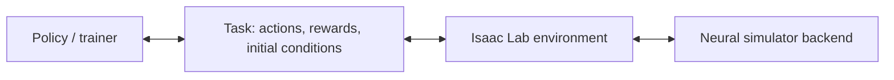

# Neural simulator backends

A neural simulator predicts environment transitions with a learned model.
Isaac Lab manages environment steps, episode limits and resets through
`SimulationContext` and `DirectRLEnv`. The backend loads the model, advances its
state and returns observations. The task defines actions, rewards and initial
conditions. The [Cosmos3 medical-pad example](#cosmos3-example-medical-pad-unfolding)
below covers setup, replay and policy training.



## Backend contract

Subclass [`NeuralPhysicsManager`](../isaaclab_contrib/neural/neural_env.py)
and implement four class methods:

| Method | Input / result |
| --- | --- |
| `_load_model()` | Load model resources once per simulator process. |
| `_reset_model(*, env_ids, seed, options)` | Reset selected environments; return `(observations, info)` in `env_ids` order. |
| `_step_model(action)` | Advance all environments; return `(observations, rewards, terminated, truncated, info)`. |
| `_close_model()` | Release resources; also handle partially completed startup. |

`N` is the number of environments; `K` is the number being reset.
Observations are a flat dictionary of NumPy arrays with leading dimension `N`
(or `K` for reset). Declare their unbatched shapes/dtypes in a Gymnasium
`Dict` of `Box` spaces; actions use a floating-point `Box`. Rewards have shape
`(N,)`; termination and truncation flags are boolean `(N,)` arrays.

The current frontend exchanges **CPU tensors** with the environment; inference
can run on a GPU. `NeuralDirectEnv` returns observations under `obs["policy"]`
and preserves terminal observations before automatic reset. Use an empty scene.
Set `decimation=1` so each environment step invokes the backend once, and match
`physics.step_dt` to `sim.dt` in seconds. For a model that predicts 16 frames at
30 frames/s, one step represents `16 / 30` seconds. Environment/backend spaces
and `num_envs` must agree. Rendering reads the current observation without
advancing model state.

## Cosmos3 example: medical-pad unfolding

This example uses Cosmos3 to predict camera images for a robot unfolding a
medical pad. A GR00T 1.7 policy generates joint commands; a five-class image
classifier supplies reward and success/failure labels.

### Requirements

Run commands from the Isaac Lab repository root, using its `.venv`.

| Workflow | Hardware | Model files |
| --- | --- | --- |
| Interface tests | CPU | None |
| Recorded-action replay | One NVIDIA GPU | World model, video encoder/decoder, text tokenizer |
| Policy training | Four NVIDIA GPUs in the supplied recipe | Replay files plus policy, policy vision backbone and reward classifier |

The training recipe assigns GPU **0–1 to policy training**, GPU **2 to policy
rollout** and GPU **3 to world-model inference**. Evaluation uses GPU 2 and 3
with the same configuration. Training splits policy parameters across the two
training GPUs to reduce per-GPU memory use.

### 1. Test the interfaces

These checks use the small reset images, recorded actions and robot kinematics
included in the task package. They do not load trained models:

```bash
uv run --frozen --extra test python -m pytest \
    source/isaaclab_contrib/test/neural \
    source/isaaclab_tasks/test/contrib/cosmos3_medical_pad_unfold -q
```

The [bundled data](../../isaaclab_tasks/isaaclab_tasks/contrib/cosmos3_medical_pad_unfold/assets)
contains one training reset, one validation reset and 64 recorded actions.
The robot description is used to convert joint targets to world-model controls;
mesh files are not required. [provenance.json](../../isaaclab_tasks/isaaclab_tasks/contrib/cosmos3_medical_pad_unfold/assets/provenance.json)
records the sample origins.

### 2. Replay recorded actions

Install the world-model dependencies:

```bash
uv sync --frozen --extra cosmos3
```

Place the following files under `.pretrained_checkpoints/medical_pad_unfold/`
(ignored by Git). The fine-tuned medical-pad world model is supplied separately
from Isaac Lab: obtain the matching export from the task/model owners. Its
required files and checksums are listed in
[artifacts.json](../../isaaclab_tasks/isaaclab_tasks/contrib/cosmos3_medical_pad_unfold/assets/artifacts.json).
The weights are needed before running replay.

| Directory | Files |
| --- | --- |
| `world_model/` | Fine-tuned medical-pad Cosmos3 export: `config.json`, weight index and seven `safetensors` shards |
| `vae/` | [Wan2.2_VAE.pth](https://huggingface.co/Wan-AI/Wan2.2-TI2V-5B/resolve/921dbaf3f1674a56f47e83fb80a34bac8a8f203e/Wan2.2_VAE.pth), the video encoder/decoder used by the world model |
| `tokenizer/` | Qwen text tokenizer: [merges.txt](https://huggingface.co/Qwen/Qwen3-VL-8B-Instruct/resolve/0c351dd01ed87e9c1b53cbc748cba10e6187ff3b/merges.txt), [vocab.json](https://huggingface.co/Qwen/Qwen3-VL-8B-Instruct/resolve/0c351dd01ed87e9c1b53cbc748cba10e6187ff3b/vocab.json), [tokenizer_config.json](https://huggingface.co/Qwen/Qwen3-VL-8B-Instruct/resolve/0c351dd01ed87e9c1b53cbc748cba10e6187ff3b/tokenizer_config.json) |

Only the three tokenizer files are needed from Qwen; its language-model weights
are not used here. Prepare the local file references, then run replay:

```bash
uv run --frozen --extra cosmos3 python scripts/tools/cosmos/prepare_medical_pad.py --replay-only

HF_HOME="$PWD/.pretrained_checkpoints/huggingface" \
uv run --frozen --extra cosmos3 isaaclab -p scripts/demos/cosmos3_replay.py \
    --checkpoint .pretrained_checkpoints/medical_pad_unfold/world_model \
    --output outputs/cosmos3/medical_pad_replay
```

The preparation script checks files/checksums and updates the model config to
reference this repository's video encoder/decoder, tokenizer and model resources. It does not
start inference or training, and downloads nothing unless `--download` is set.
`HF_HOME` keeps the model cache inside the repository.

Replay starts from the bundled image and predicts four clips, each conditioned
on 16 recorded actions. The last generated image conditions the next clip.
A new output directory receives `generated.mp4` and `results.json`.
Override `--initial-image`, `--prompt` and `--actions` to replay another recording.

### 3. Train and evaluate the policy

Install the policy/trainer dependencies and add these model files:

```bash
uv sync --frozen --extra cosmos3-rl
```

| Directory | Files |
| --- | --- |
| `policy/` | [Medical-pad GR00T 1.7 policy export](https://huggingface.co/nvidia/s2r_models_dev/tree/e0d010ae73194772844a4ed7838f88775a436030/yunl/sft/h2/medical_pad/teleop1103-b64-10k); access to the model repository is required |
| `backbone/` | [Cosmos-Reason2-2B files](https://huggingface.co/nvidia/Cosmos-Reason2-2B/tree/9ce19a195e423419c349abfc86fd07178b230561), used by the policy to encode images and task text |
| `classifier/` | Matching five-class `reward_model.pt`, supplied separately by the task/model owners; architecture/preprocessing are in the bundled `classifier.yaml` |

All directories are under `.pretrained_checkpoints/medical_pad_unfold/`.
The policy was first trained on demonstrations. RL updates that policy while
the world model and reward classifier stay fixed. The supplied algorithm is
**GRPO**: it compares rewards within groups of rollouts to compute policy updates.

```bash
uv run --frozen --extra cosmos3-rl python scripts/tools/cosmos/prepare_medical_pad.py

# Train for one update, including evaluation before and after it.
HF_HOME="$PWD/.pretrained_checkpoints/huggingface" OMP_NUM_THREADS=4 \
uv run --frozen --extra cosmos3-rl isaaclab train --rl_library rlinf \
    --config_path "$PWD/.pretrained_checkpoints/medical_pad_unfold" \
    --config_name medical_pad_unfold --max_iterations 1

# Evaluate the saved policy and save a video.
HF_HOME="$PWD/.pretrained_checkpoints/huggingface" OMP_NUM_THREADS=4 \
uv run --frozen --extra cosmos3-rl isaaclab play --rl_library rlinf \
    --config_path "$PWD/.pretrained_checkpoints/medical_pad_unfold" \
    --config_name medical_pad_unfold --checkpoint latest --num_episodes 1 --video
```

The helper writes `medical_pad_unfold.yaml` with local absolute paths and selects
PyTorch's built-in policy attention. Existing generated YAML files are kept to
preserve experiment edits. For a shorter integration check, prepare with
`--smoke` and use `--config_name medical_pad_unfold_smoke`; this shortens the
horizon to 64 frames and reduces the training batch. The full recipe runs for
480 frames, with four training environments, groups of two rollouts and one
evaluation environment.

To evaluate the initial demonstration-trained policy, omit `--checkpoint` from
play. To resume training, add `--checkpoint latest` to train and increase
`--max_iterations` to the desired total update count. An explicit checkpoint
path can be used in place of `latest`.

Logs are saved under `logs/rlinf/`; play runs are under `logs/rlinf/eval/`.
`eval/success_once` in TensorBoard is the fraction of episodes reaching the
configured success condition. The bundled data has one validation scene;
increasing episode count repeats that scene. Add resets before comparing
success rates across scenes.

#### Task behavior and files

The classifier assigns five ordered status scores `[-2,-1,0,1,2]`. Reward is the
change in its expected score. Class 4 is configured as success and class 0 as
failure, requiring 30 consecutive matching frames. At the time limit, the
recipe also counts a final success label as success. A 16-frame clip completes
before termination is reported; the terminal image is the clip's last frame.
Joint state starts from recorded measurements and then tracks commanded joint
targets; Cosmos predicts the camera images.

| File | Responsibility |
| --- | --- |
| [Cosmos manager/config](../isaaclab_contrib/neural/cosmos3/env_cfg.py) | Connect learned dynamics and a task reward callback to Isaac Lab's simulation lifecycle |
| [Cosmos inference](../isaaclab_contrib/neural/cosmos3/simulator.py) | Load the model and predict image clips |
| [Medical-pad task](../../isaaclab_tasks/isaaclab_tasks/contrib/cosmos3_medical_pad_unfold/rlinf_env.py) | Select resets, apply task rules and assemble RLinf's per-frame observations, rewards and episode information |
| [Action conversion](../../isaaclab_tasks/isaaclab_tasks/contrib/cosmos3_medical_pad_unfold/h2_action_codec.py) | Convert robot joint commands to the world model's normalized controls |
| [Reward classifier](../../isaaclab_tasks/isaaclab_tasks/contrib/cosmos3_medical_pad_unfold/classifier.py) | Load the image classifier and calculate status scores |

### Use different model weights

For another compatible Cosmos checkpoint, change replay's `--checkpoint`, or
set both `env.train.isaaclab.world_model.checkpoint_path` and
`env.eval.isaaclab.world_model.checkpoint_path` in a copied training YAML.
The example uses a Hugging Face export (config plus `safetensors` files).
PyTorch Distributed Checkpoint inputs additionally require their saved model
YAML: `--config-file` for replay or `world_model.config_file` in a recipe.

The task expects `mode: window`: each step predicts a fresh clip from the current
image and 16 actions. The model must accept `unified_v1`, Cosmos's normalized
59-value robot-control format. The policy produces 16 rows of 58 absolute H2
joint targets; the task converts these to world-model controls. Changes to action
meaning, dimensions or clip length require matching conversion and spaces.
See [Implement a backend](#implement-a-backend) to add a different model backend.

For a compatible GR00T policy export, change `actor.model.model_path`; rollout
follows that setting. Train/play also accept `--model_path`. Supply its matching
processor, normalization metadata and `actor.model.backbone_model_path`.
`gr00t_mapping` and `action_mapping.keys` define the robot observation/action
mapping. Train/play `--checkpoint` selects RL-trained policy weights, with the
base export supplying architecture and preprocessing resources.

### Dependency configuration

The extras use the repository's normal `.venv`; revisions and the selected
runtime dependencies are in `pyproject.toml` and `uv.lock`. The shared Torch and
NumPy versions are unchanged. Cosmos requires Transformers 4 and GR00T requires
4.57.3, so Linux installs select 4.57.3, including base installs; Windows retains
5.10.4. The inference/training profile installs the components used by this
example and omits standalone SDK training/deployment tools. Detailed local
dependency overrides do not change SDK source code.

## Implement a backend

This small state-update example demonstrates the shapes and lifecycle. Replace
its state update with model inference; reset only the requested rows.

```python
import numpy as np
import torch
from gymnasium import spaces
from isaaclab.physics import PhysicsManager
from isaaclab_contrib.neural import NeuralDirectEnv, NeuralDirectEnvCfg, NeuralPhysicsCfg, NeuralPhysicsManager

class ExamplePhysicsManager(NeuralPhysicsManager):
    @classmethod
    def _load_model(cls):
        cls.state = np.zeros((PhysicsManager._cfg.num_envs, 1), np.float32)

    @classmethod
    def _reset_model(cls, *, env_ids, seed, options):
        cls.state[env_ids] = 0
        return {"state": cls.state[env_ids].copy()}, {}

    @classmethod
    def _step_model(cls, action):
        cls.state += action
        n = len(cls.state)
        return {"state": cls.state.copy()}, np.zeros(n, np.float32), np.zeros(n, bool), np.zeros(n, bool), {}

    @classmethod
    def _close_model(cls):
        cls.state = None
```

Select the manager in `NeuralPhysicsCfg` and give the environment matching spaces:

```python
actions = spaces.Box(-1.0, 1.0, (1,), np.float32)
observations = spaces.Dict({"state": spaces.Box(-np.inf, np.inf, (1,), np.float32)})
cfg = NeuralDirectEnvCfg(action_space=actions, observation_space=observations, episode_length_s=1.0)
cfg.sim.dt = 0.1
cfg.sim.physics = NeuralPhysicsCfg(
    class_type=ExamplePhysicsManager, action_space=actions,
    observation_space=observations, num_envs=1, step_dt=cfg.sim.dt,
)
env = NeuralDirectEnv(cfg)
try:
    obs, info = env.reset()
    obs, reward, terminated, truncated, info = env.step(torch.full((1, 1), 0.5))
    print(obs["policy"]["state"])
finally:
    env.close()
```

Keep optional model imports inside the backend's load/inference methods and
place dependencies in a root-project extra. The
[Cosmos3 manager](../isaaclab_contrib/neural/cosmos3/env_cfg.py) illustrates
image observations and a task-provided reward callback.

## Connect a task to RLinf

[`NeuralRlinfEnv`](../isaaclab_contrib/rl/rlinf/neural_env.py) runs a task in a
simulator subprocess, keeping train/evaluation simulation contexts independent.
Set these fields under both `env.train.isaaclab` and `env.eval.isaaclab`:

```yaml
env_wrapper: isaaclab_contrib.rl.rlinf.neural_env:NeuralRlinfEnv
env_factory: your_package.task:create_env
```

The factory takes `(cfg, *, num_envs, seed)` and returns an object exposing
`reset`, `chunk_step`, `update_reset_state_ids` and `close`. Here a **chunk** is
`C` consecutive actions predicted by the policy. `chunk_step` returns `C`
observations, reward/termination/truncation arrays shaped `(N, C)`, and `C` info
dictionaries. The task supplies policy observation conversion, action conversion
and task metrics; the backend remains responsible for learned dynamics.
See the [medical-pad task](../../isaaclab_tasks/isaaclab_tasks/contrib/cosmos3_medical_pad_unfold/rlinf_env.py)
and its [training recipe](../../isaaclab_tasks/isaaclab_tasks/contrib/cosmos3_medical_pad_unfold/agents/isaaclab_cosmos3_grpo_medical_pad_unfold.yaml)
for a concrete factory and configuration.
